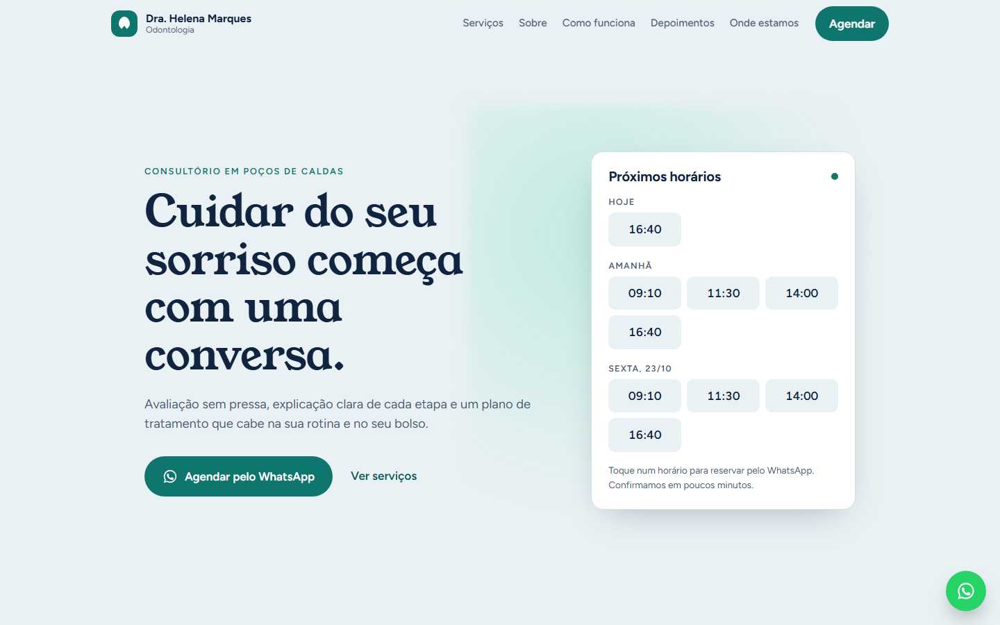

# Landing page para consultório

**Veja funcionando:** https://deborahdalonso.github.io/landing-page-demo/

Landing page para consultório, feita para uma única coisa: levar o paciente ao agendamento pelo WhatsApp em um toque. O modelo é de odontologia, mas serve para qualquer profissional de saúde ou prestador de serviço que agenda horários.

## O que tem na página

- **Próximos horários no topo**: hoje, amanhã e o próximo dia útil. Cada horário abre o WhatsApp com a mensagem já escrita, por exemplo "Gostaria de agendar uma avaliação amanhã às 11:30".
- **Serviços**, **sobre a profissional** e **como funciona** o atendimento, do primeiro contato ao plano de tratamento.
- **Depoimentos** de pacientes.
- **Localização**, horários de atendimento e botão "Como chegar".
- **Botão de WhatsApp fixo** na tela e menu que vira gaveta no celular.

## Como foi feita

- **HTML, CSS e JavaScript puros**, sem WordPress, construtor de sites ou framework. Carrega rápido e não depende de plugin.
- **Responsiva**: pensada primeiro para o celular, que é por onde o paciente chega.
- **Fácil de adaptar**: nome, telefone, endereço, horários e cores ficam concentrados em poucos lugares, então trocar de cliente leva pouco tempo.
- **Acessível**: navegação por teclado, contraste adequado e animações que respeitam quem prefere menos movimento.
- **Publicação estática** no GitHub Pages; para um cliente, pode ir para qualquer hospedagem.

Este repositório contém só a versão publicada. Nomes, depoimentos e dados são fictícios.

Desenvolvido por [Deborah Dalonso](https://www.linkedin.com/in/deborah-dalonso-482099138).
